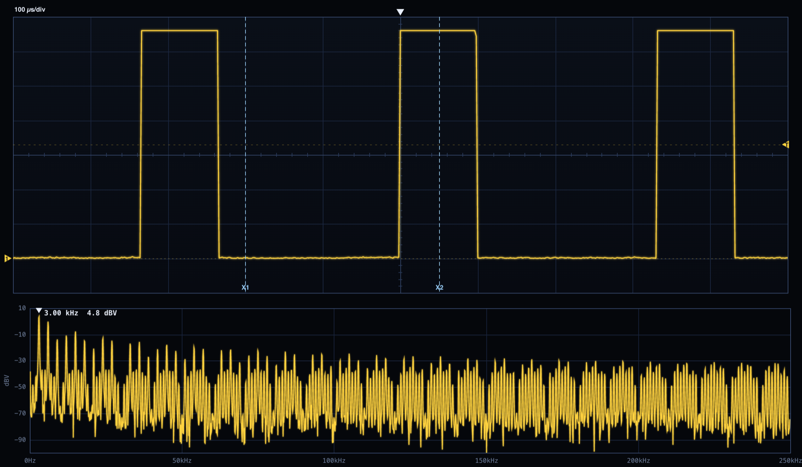
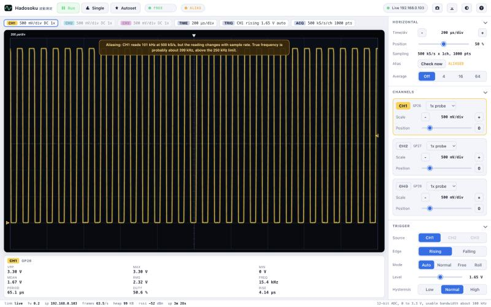
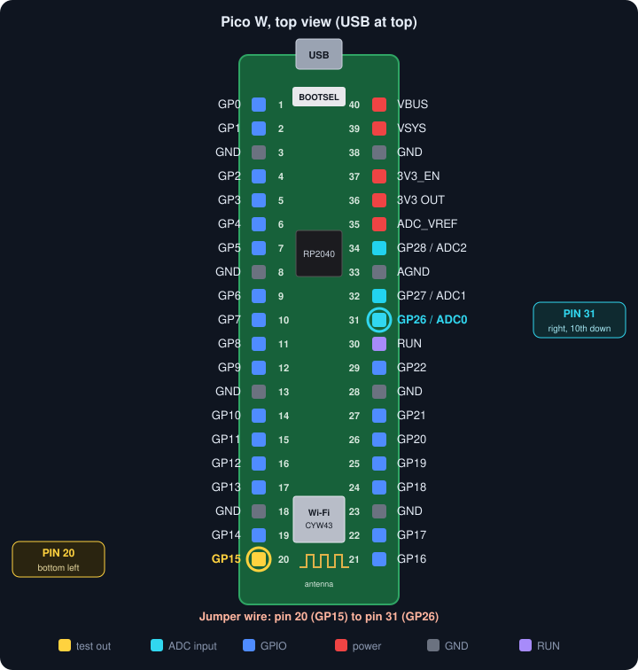
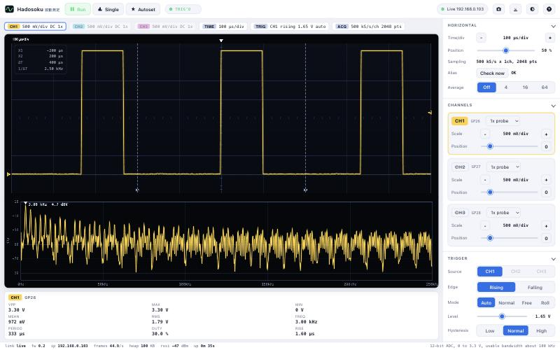
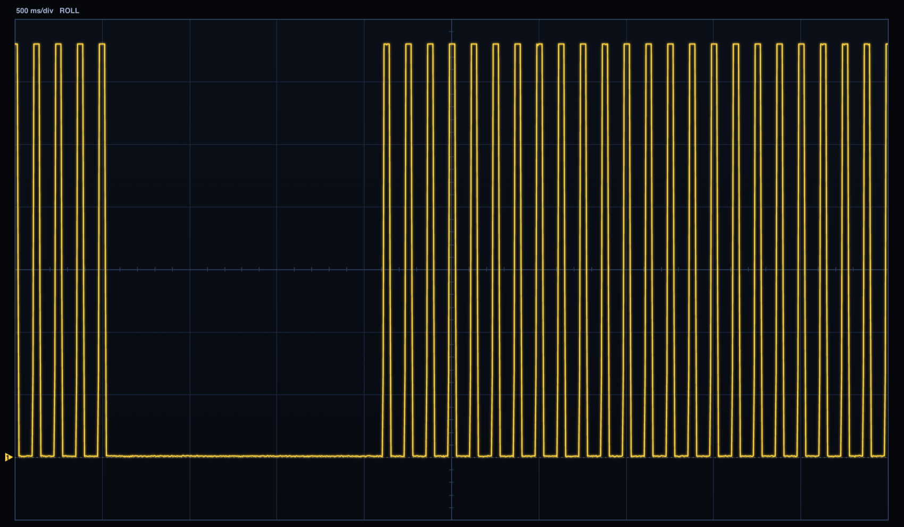
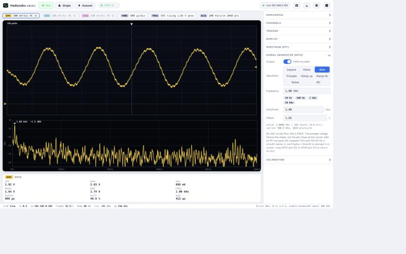

# Hadosoku 波動測定

A browser-based oscilloscope for the Raspberry Pi Pico W. The board samples
three analog inputs at up to 500 kS/s, finds the trigger, and serves the user
interface and the data stream itself over Wi-Fi. There is nothing to install on
the computer: open the board's address in any modern browser. The same board can also act as a
signal generator: square, pulse, sine, triangle, ramps, noise and DC.

*Hadosoku* is a portmanteau of the Japanese words for wave (波動, *hadō*) and
measurement (測定, *sokutei*).



*A real 3 kHz, 30 % duty square wave captured by a Pico W, with time cursors
and the 4096-point spectrum. The screen above is the UI's own full-resolution
render.*

## Contents

- [Features](#features)
- [Specifications](#specifications)
- [Hardware](#hardware)
- [Quick start](#quick-start)
- [Using the scope](#using-the-scope)
- [Signal generator](#signal-generator)
- [How it works](#how-it-works)
- [Wire protocol](#wire-protocol)
- [Project layout](#project-layout)
- [Developing](#developing)
- [Troubleshooting](#troubleshooting)
- [Known limitations](#known-limitations)
- [License](#license)
- [Acknowledgements](#acknowledgements)

## Features

- **Three channels**, 12-bit, up to 500 kS/s in total (shared between the
  enabled channels), on GP26, GP27 and GP28.
- **Hardware sampling**: the ADC free-runs and a DMA channel fills RAM, so the
  CPU is never in the sampling loop and there are no timing gaps.
- **Edge trigger** (rising or falling, adjustable level, hysteresis and
  pre-trigger position) with Auto, Normal, Free-run and Single modes.
- **Roll mode** for slow signals, from 10 ms/div up to 10 s/div. It streams
  continuously with no gaps and averages down to about 1000 points per screen,
  which also reduces noise. It switches on automatically at 200 ms/div and
  slower.
- **Aliasing detection.** The scope warns when a signal is too fast for the
  current sample rate, and estimates the true frequency. See
  [Aliasing](#aliasing).
- **Measurements** for every channel: Vpp, max, min, mean, RMS, frequency,
  period, duty cycle and rise time.
- **Spectrum (FFT)** with 1k to 8k points, Hann, Blackman or rectangular
  windows, linear or log frequency axis, and a peak readout in dBV.
- **Cursors** (time, voltage or both), **persistence**, **frame averaging**,
  sinc interpolation, a 10x probe setting and a calibration field for the ADC
  reference voltage.
- **Autoset**, keyboard shortcuts, **PNG** and **CSV** export, light and dark
  themes, and a layout that works on a phone.
- **Signal generator** on GP15: square and pulse waves with exact timing
  (0.02 Hz to 12.5 MHz, 8 ns resolution, burst counts, polarity), plus
  PWM-encoded sine, triangle, ramps, noise and DC levels. With one jumper wire
  from GP15 to GP26 you can test everything without any other equipment. See
  [Signal generator](#signal-generator).
- **Smooth** display filter (a boxcar average, like the hi-res mode on bench
  scopes) that reveals the shape of PWM-encoded signals without any extra parts.
- **Demo mode**: the UI runs without any hardware against a simulated Pico
  that speaks the same protocol.



## Specifications

| | |
|---|---|
| Inputs | 3 (GP26 / ADC0, GP27 / ADC1, GP28 / ADC2), DC coupled |
| Input range | 0 to 3.3 V. **Never exceed this range.** |
| Resolution | 12-bit converter. The RP2040 ADC has known non-linearity, so expect roughly 9 effective bits (from the RP2040 datasheet, not measured here). |
| Sample rate | 500 kS/s total. 1 channel: 500 kS/s, 2 channels: 250 kS/s each, 3 channels: 166 kS/s each. |
| Timebase | 20 µs/div to 10 s/div (1-2-5 steps), 10 divisions across |
| Trigger | Edge, rising or falling. Search takes 0.2 to 5 ms on the board. |
| Capture depth | Up to 16384 points per channel (limited by 64 KB of capture RAM, shared between channels) |
| Frame rate | About 60 to 185 frames/s at normal timebases, about 5 to 12 frames/s with an 8192-point spectrum. Measured over Wi-Fi with one client. |
| UI size | About 24 KB (gzip) in the board's flash |
| Free RAM at runtime | About 95 KB |
| Generator | Digital: 0.02 Hz to 12.5 MHz, 8 ns steps. Analog (PWM-encoded): 0.05 Hz to 100 kHz, about 8 bits, 0 to 3.3 V. One output, GP15. |

### Measured accuracy

Measured on one board, using the built-in 3.3 V square wave on GP15 looped to
GP26 with a jumper wire, read back through the UI:

| Generator | Reading | Error |
|---|---|---|
| 100 Hz | 100.0 Hz | 0 % |
| 1 kHz | 1.000 kHz | 0 % |
| 10 kHz | 9.9998 kHz | -0.002 % |
| 100 kHz | 100.0 kHz | 0 % |
| 200 kHz | 199.99 kHz | -0.01 % |
| 240 kHz | 239.92 kHz | -0.03 % |
| 300 kHz | 200 kHz | wrong, aliased |

Generator output, measured with the same loopback (digital outputs read at
500 kS/s; analog outputs viewed with Smooth set to 64):

| Setting | Measured |
|---|---|
| Square 1 kHz, 50 kHz | 1.000 kHz and 50.000 kHz, duty 50.0 % |
| Pulse 10 µs in 1 ms | duty 1.00 %; a 2 µs pulse (one ADC sample) read 0.20 % |
| Pulse 250 µs in 1 ms, inverted | duty 25.0 %, and 75.0 % when inverted |
| Burst of 5 pulses at 100 Hz | exactly 5 pulses, spaced exactly 10.0 ms (4 of 4 captures) |
| Sine 1 kHz, 2.0 Vpp, 1.65 V offset | 2.03 Vpp, 1.649 V mean, 998 Hz |
| Triangle 1 kHz, 2.0 Vpp | 1.87 Vpp, 1.651 V mean (the smoothing rounds the peaks) |
| Ramps 1 kHz, 1.0 Vpp, 1.0 V offset | 0.93 and 0.94 Vpp, 1.00 V mean |
| DC 0.50 V, 2.50 V | 0.488 V and 2.494 V, with 0.1 to 0.3 V of peak-to-peak ripple left without an RC filter |

Read these numbers with care:

- The generator and the ADC are both derived from the Pico's crystal, so a
  crystal error cancels out in this test. Absolute accuracy against an outside
  reference has not been measured; expect it to be limited by the crystal
  (typically tens of ppm).
- Only a square wave was available. Amplitude flatness for sine waves, and the
  analog bandwidth of the ADC input, have not been characterised. The scope
  read the full 3.30 V amplitude at 240 kHz.
- A reading being correct is not the same as the waveform looking right. With
  one channel, a square wave looks like a square wave up to about 50 kHz
  (10 samples per cycle) and is recognisable up to about 100 kHz (5 samples per
  cycle). Frequency readings stay correct up to about 240 kHz, and fail above
  250 kHz (half the sample rate). With more channels enabled, all of these
  limits drop in proportion.

## Hardware

You need a Raspberry Pi Pico W (the original, RP2040). A Pico 2 W (RP2350) has
not been tried and the ADC and DMA register addresses used here are RP2040
specific.

| Signal | Pico pin | GPIO | Notes |
|---|---|---|---|
| CH1 | 31 | GP26 (ADC0) | |
| CH2 | 32 | GP27 (ADC1) | |
| CH3 | 34 | GP28 (ADC2) | |
| Generator out | 20 | GP15 | Digital 3.3 V, or PWM-encoded analog |
| Ground | 33 (AGND) or any GND | | Use AGND for the cleanest readings |



To try it with no other equipment, connect **pin 20 (GP15) to pin 31 (GP26)**
with one jumper wire.

**Protect the inputs.** The ADC pins are not 5 V tolerant, and the Pico has no
input protection of its own. To measure anything above 3.3 V, or anything that
could go below 0 V, add a resistor divider and clamp the input yourself (for
example a series resistor of a few kilohms with Schottky diodes to 3V3 and
ground). The UI's *10x probe* setting rescales the display if you add a 10:1
divider. This protection circuit is a suggestion; it has not been built or
tested as part of this project.

## Quick start

### 1. Install MicroPython

Install a MicroPython build for the Pico W from
<https://micropython.org/download/RPI_PICO_W/>. This project was developed on
**v1.23.0 (2024-06-02)**. It needs `rp2.DMA` and `machine.mem32`, so use 1.22 or
newer.

### 2. Get the code and the host tools

```bash
git clone https://github.com/martinbogo/hadosoku.git
cd hadosoku
python3 -m pip install pyserial
```

The host tools need only Python 3 and `pyserial`. They talk to the board over
its USB serial port (`/dev/cu.usbmodem*` on macOS; edit `find_port()` in
`tools/pico.py` for Linux or Windows).

### 3. Give the board your Wi-Fi details

```bash
python3 tools/setup_wifi.py
```

This asks for your network name and password (the password is hidden as you
type) and writes `secrets.py`, which is git-ignored. The Pico supports 2.4 GHz
networks only.

### 4. Deploy

```bash
python3 tools/pico.py deploy      # copies firmware and the UI to the board
python3 tools/pico.py reset 12    # reboots it and prints the IP address
```

You should see something like:

```
wifi station 192.168.0.103
Hadosoku 0.3 ready: http://192.168.0.103/  (station)  free=104464
```

### 5. Open it

Browse to the address printed above. The board starts the server automatically
every time it is powered, so after this step it needs no computer, just USB
power.

If no `secrets.py` is present, or the board cannot join the network, it starts
its own access point instead: network `Hadosoku`, password `hadosoku`, address
`http://192.168.4.1/`. That password is public, so treat this mode as a
fallback for setup only.

## Using the scope



Click **Run / Stop**, **Single** or **Autoset** in the top bar, or use the
keyboard.

| Key | Action |
|---|---|
| `Space` | Run / stop |
| `S` | Single capture |
| `A` | Autoset |
| `Left` / `Right` | Time per division (the mouse wheel also works) |
| `Up` / `Down` | Volts per division of the active channel (`Shift` + wheel also works) |
| `1` `2` `3` | Select a channel (hold `Shift` to show or hide it) |
| `T` | Cycle trigger mode |
| `E` | Toggle trigger edge |
| `C` | Cycle cursors |
| `F` | Show or hide the spectrum |
| `P` | Save a screenshot |
| `?` | Show the shortcut list |

Drag the arrows on the screen's edges: the left edge sets each channel's zero
level, the right edge sets the trigger level and the top edge sets the trigger
position. While the scope is stopped you can still zoom the time axis and place
cursors on the captured data.

### Trigger modes

| Mode | Behaviour |
|---|---|
| Auto | Triggers if it can, otherwise shows the waveform untriggered so the screen is never blank. |
| Normal | Only updates the screen when a trigger is found. |
| Free | Never triggers; shows every capture. |
| Roll | Continuous scrolling display with no trigger (see below). |
| Single | The *Single* button: arm, capture once on the next trigger, then stop. |

### Roll mode

Triggered capture needs the whole window of samples before it can show
anything, which is unusable when the window is several seconds long. Roll mode
streams samples continuously, with the newest at the right edge of the screen.

It turns on by itself at 200 ms/div and slower. You can also force it from
10 ms/div with the *Roll* button in the Trigger panel.



*Roll mode at 500 ms/div on a real board: an 8 Hz wave with the generator
switched off twice. Five seconds of history are on screen.*
 The spectrum, Single
capture and the trigger controls are not available in roll mode, and the UI
says so.

### Aliasing

If a signal is faster than half the sample rate, a sampled scope shows a wrong,
lower frequency, and nothing on the waveform tells you. Hadosoku checks for
this in two ways:

1. **Close to the limit.** If a reading is above 0.4 times the sample rate the
   UI shows a "close to the limit" notice, because measurements are already
   unreliable there.
2. **Active check.** Every few seconds the UI briefly captures the signal again
   at a different sample rate (0.77 times the first). A real signal reads the
   same at both rates; an aliased one does not. When they disagree, the UI
   shows the amber *ALIAS* chip, a banner, and the most likely true frequency.
   The captures used for the check are never displayed, so the screen does not
   flicker. If the first attempt is too noisy to judge (a PWM carrier can look
   like noise at an unlucky second rate), it tries two other rates. When Smooth
   is on, the check looks through the same filter as the display.

The automatic check is skipped in roll mode and below 10 kS/s, where a check
would take too long. The *Check now* button in the Horizontal panel runs it on
demand at any rate except in roll mode. It can only judge periodic signals. A signal sitting at an
exact multiple of the sample rate looks like DC and cannot be recognised.

## Signal generator

The **Signal generator** panel drives GP15. Choose a waveform, then set its
parameters; the board reports back what it actually produced (for example the
exact frequency and the number of PWM levels).

| Waveform | Parameters | How it is made |
|---|---|---|
| Square | frequency 0.02 Hz to 12.5 MHz, duty 0 to 100 %, invert | PIO state machine, exact cycle counts |
| Pulse | rate, width (24 ns and up), count (0 = continuous), invert, **Fire** button | PIO state machine; a finite count makes a burst that **Fire** repeats |
| Sine, Triangle (adjustable symmetry), Ramp up, Ramp down | frequency 0.05 Hz to 100 kHz, amplitude (Vpp), offset | PWM duty values streamed by DMA |
| Noise | update rate 10 Hz to 500 kHz, amplitude, offset | random PWM duty values, 1024-entry table |
| DC | level 0 to 3.3 V | fixed PWM duty |



### Digital outputs (square, pulse)

These are real logic signals. The PIO program toggles the pin with a
deterministic number of clock cycles, so timing is exact to 8 ns and has no
jitter from the CPU or Wi-Fi. Square and continuous pulse trains run forever on
their own. A pulse burst (count above 0) fires once as soon as you enable it or
change a setting, runs the requested number of pulses, then idles; press **Fire**
to repeat it. Timing above about 240 kHz is exact by construction, but the
board's own 500 kS/s ADC cannot be used to check it.

### Analog outputs (sine, triangle, ramps, noise, DC)

**The RP2040 has no DAC.** These waveforms are PWM-encoded: the average voltage
of the pin follows the shape you asked for, but the pin itself switches between
0 V and 3.3 V at a carrier of about 309 kHz (about 8 bits of level resolution).
For a smooth analog signal, add an RC low-pass filter between GP15 and what you
are driving. As a starting point, a resistor R and capacitor C to ground give a
cutoff of 1 / (2 pi R C); for example 1.6 kohm and 100 nF is about 1 kHz, and
160 ohm and 100 nF is about 10 kHz. Keep the cutoff well below the carrier but
above your waveform frequency. This filter is a suggestion and has not been
built or tested as part of this project.

With only a jumper wire (GP15 to GP26) the scope sees the raw PWM. The **Smooth**
setting in the Display panel averages it on screen and shows the intended shape;
**64** is a good value for waveforms up to a few kHz. The aliasing check looks
through the same filter.

How the table is played matters for how clean this looks: the DMA timer updates
the PWM duty at a rate set by the waveform frequency, while the PWM carrier
itself stays near 309 kHz (about 0.618 times 500 kS/s), so that the ADC samples
the carrier at well-spread phases and the average converges quickly. Below about
2 Hz the DMA timer cannot go slow enough and the carrier follows the table rate
instead.

## How it works

```
 analog input --> RP2040 ADC (free-running, 12-bit)
                      |  DREQ
                      v
              DMA channel(s) --> 64 KB buffer in RAM
                                     |
                      viper trigger search (MicroPython, native speed)
                                     |
              asyncio HTTP + WebSocket server --Wi-Fi--> browser
                                                         (canvas UI, all DSP:
                                                          measurements, FFT,
                                                          interpolation)
```

- **Capture** (`firmware/capture.py`). The ADC is configured directly through
  its registers: a divider sets the rate, the FIFO feeds a DMA channel, and
  round-robin mode interleaves the enabled channels. A divider value of 95
  (one cycle short of the 96-cycle conversion time) was observed to halve the
  real sample rate, so rates near the ceiling use the ADC's free-running mode
  instead.
- **Trigger.** After a block has been captured, a `@micropython.viper` function
  scans it for the edge. It takes 0.2 to 5 ms and returns the sample index, from
  which the window with the requested pre-trigger samples is cut.
- **Roll mode.** Two DMA channels are chained so that each starts the other
  when it finishes, writing to two halves of the buffer. The firmware polls how
  far the active half has filled and sends new samples about every 25 ms, then
  re-arms the finished half. Captured edges stayed exactly the expected number
  of samples apart across tests, so no samples are lost at the switchover.
- **Server** (`firmware/server.py`). A small asyncio HTTP server delivers the
  gzipped page, and a minimal WebSocket implementation streams frames. There
  are no third-party libraries on the board.
- **Browser.** All the heavy work happens in the browser (`www/index.html`, one
  file with no dependencies): drawing, measurements, the FFT, interpolation and
  the aliasing logic. The Pico only samples, triggers and sends.

## Wire protocol

Browser to board, JSON text frames:

| Message | Fields |
|---|---|
| `cfg` | `mask` (bit per ADC input), `rate` (per channel, S/s), `len` (samples per channel), `pre` (samples before the trigger), `src`, `level` and `hyst` (raw 12-bit), `edge` (`r` or `f`), `mode` (`auto`, `normal`, `free`, `single`), `run`, `roll` |
| `run` | `on` |
| `gen` | `on`, `wave` (`square`, `pulse`, `sine`, `triangle`, `ramp_up`, `ramp_down`, `noise`, `dc`), `freq`, `duty`, `amp`, `off`, `sym`, `width` (seconds), `count`, `invert` |
| `fire` | none; emits one burst in pulse mode with a finite count |

Board to browser, JSON text frames: `hello` (firmware version, address, current
configuration and generator state) once on connect, `genstate` (the generator
state after clamping, plus the values actually achieved) after every `gen` or
`fire`, `bye` when another browser takes over the connection, and `stat` (state, frames per second, free
memory, Wi-Fi signal, uptime) about once a second.

Board to browser, binary frames: a 16-byte little-endian header
(`struct` format `<BBHBBHIHH`) followed by interleaved unsigned 16-bit samples.

| Field | Type | Meaning |
|---|---|---|
| magic | u8 | `0x53` |
| flags | u8 | bit 0: triggered, bit 1: roll chunk |
| seq | u16 | frame counter |
| mask | u8 | enabled ADC inputs |
| nch | u8 | number of channels |
| n | u16 | samples per channel |
| rate | u32 | per-channel sample rate in S/s |
| pre | u16 | trigger index in the window, or `0xFFFF` if untriggered |
| spare | u16 | reserved |

Roll chunks (flag bit 1) carry new samples only and are appended to a rolling
history by the browser.

## Project layout

```
firmware/        MicroPython code that runs on the board
  main.py          start-up: Wi-Fi, then the server
  net.py           join the network, or fall back to an access point
  capture.py       ADC + DMA capture, trigger search, roll-mode ring buffer
  gen.py           signal generator on GP15 (PIO digital, DMA + PWM analog)
  server.py        HTTP + WebSocket server and the acquisition loop
www/index.html   the entire user interface (one file, no dependencies)
tools/
  pico.py          upload / run / reset over USB serial (needs only pyserial)
  setup_wifi.py    writes secrets.py (git-ignored)
  pinout_svg.py    regenerates docs/pinout.svg
docs/            images used by this README
```

## Developing

**The UI needs no hardware.** Serve the `www` folder and open it with `?demo`:

```bash
python3 -m http.server 8765 --directory www
# then browse to http://localhost:8765/?demo
```

Demo mode runs a simulated Pico (including trigger logic, roll mode and real
aliasing) that produces the same binary frames as the firmware.

To use your local copy of the UI with a real board, add its address:
`http://localhost:8765/?device=192.168.0.103`. The board serves one client at a
time, so close other tabs first.

**Firmware.** Edit `firmware/*.py`, then `python3 tools/pico.py deploy` and
`python3 tools/pico.py reset 12`. Other `pico.py` commands: `ls`, `put`, `rm`
and `exec` (run a script on the board and print its output).

There is no automated test suite yet. The hardware behaviour described above
was checked with throwaway scripts run through `pico.py exec`.

## Troubleshooting

| Symptom | What to try |
|---|---|
| Page never loads | Check the IP printed by `pico.py reset`. The board must be on the same network as the computer, and 2.4 GHz only. |
| "Connection lost, retrying" | The Wi-Fi link dropped; the page reconnects by itself. |
| "Another browser took over this scope" | The board serves one client and the newest connection wins. The older page stops retrying so the two do not fight; click the connection chip to take it back. |
| Sine or triangle looks like a noisy square wave | That is the PWM carrier. Set Display > Smooth to 32 or 64, or add an RC filter. |
| Board made its own `Hadosoku` network | It could not join your Wi-Fi. Re-run `tools/setup_wifi.py` and deploy again. |
| Flat line at about 50 mV | The input is floating or the jumper is not connected. Check pin 20 to pin 31. |
| Wrong frequency at high speeds | Probably aliasing. Look for the ALIAS chip and lower the signal frequency. |
| `MemoryError` on the serial console | Reset the board. Free RAM is about 100 KB; very large spectra on three channels use the most. |
| Cannot find the serial port | Edit `find_port()` in `tools/pico.py` for your system. |

## Known limitations

- **No authentication or encryption.** Anyone on your network can open the page
  and drive the test-signal pin. Do not expose the board to the internet. The
  Wi-Fi password is stored in plain text in the board's flash.
- **One client at a time.**
- **Generator.** One output pin. Analog shapes are PWM-encoded with about 8 bits
  of resolution and are only useful to a few tens of kHz (at 100 kHz there are
  only about 3 samples per cycle). Digital timing is exact, but a very short
  one-off burst can fall between the scope's capture blocks; see below.
- **Single-shot capture is block based,** so the scope is briefly blind between
  blocks. A one-off event much shorter than a capture block can be missed.
  Bursts that fit inside the capture window (for example five pulses at 100 Hz
  with 5 ms/div) were captured 4 out of 4 times, while very short bursts of a
  few milliseconds were caught only intermittently in testing.
- **Single-ended, DC-coupled, 0 to 3.3 V inputs only,** with no input
  protection on the board.
- **ADC quality.** The RP2040 ADC is 12-bit with known non-linearity, and its
  accuracy depends on the supply and source impedance. Use the *ADC ref* field
  to calibrate against a multimeter reading of the 3V3 pin.
- **Bandwidth.** Usable bandwidth is about 100 kHz on one channel. Higher
  frequencies alias, and the scope warns about this but cannot undo it.
- **Triggered mode needs a periodic signal in the window.** At slow timebases
  use roll mode.
- Only tested with MicroPython v1.23.0 on a Pico W (RP2040), a macOS host, and
  one Chromium-based browser.

## License

Copyright (c) 2026 Martin Bogomolni.

Hadosoku is licensed under the [Creative Commons Attribution-NonCommercial 4.0
International License](https://creativecommons.org/licenses/by-nc/4.0/)
(CC BY-NC 4.0). In short: you may share and adapt it for **non-commercial**
purposes, as long as you credit Martin Bogomolni, link to the license, and say
if you changed anything. See [LICENSE](LICENSE) for the full terms.

Note that this is not an OSI-approved open source license, because it
forbids commercial use. Contact the author if you want to use Hadosoku
commercially.

## Acknowledgements

Built on [MicroPython](https://micropython.org/) and the RP2040's ADC and DMA
hardware.

Raspberry Pi and Pico are trademarks of Raspberry Pi Ltd. PicoScope is a
trademark of Pico Technology Ltd. This project is not affiliated with or
endorsed by either company; it is named Hadosoku specifically to avoid
confusion with Pico Technology's products.
